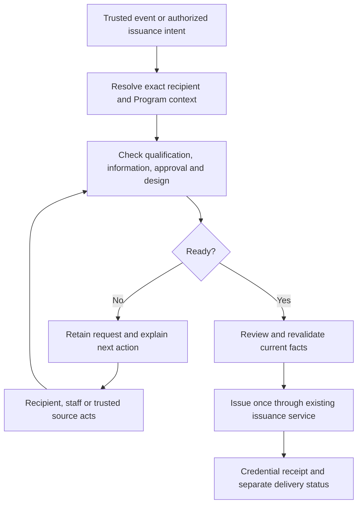

# Certloom: Program setup, recipient details and issuance implementation plan

Date: 2 October 2026
Status, updated 8 October: the pre-release Program/recipient implementation and the requested remaining recovery/lifecycle/native/widget work are complete within the recorded source and environment boundaries. See the [completion report](CERTLOOM-REMAINING-WORK-CLOSURE-2026-10-08.md). Release validation and installed LearnDash acceptance remain separate.
User review, 8 October: newer screens need a UI consistency and process-simplification review before product split/release sign-off. Sync the current implementation to GitHub first; the user is installing LearnDash manually in Local. Functional acceptance does not close this UX review.
Purpose: Working specification and execution checklist. Proposed names in the original specification may differ from the implemented services; the current acceptance report takes precedence over historical checkpoints.

## 1. Decision and architectural fit

Use a Program as the center of the customer workflow. Extend Certloom's existing field hierarchy, exact account linkage, reviewed issuance service, immutable credential Versions and durable jobs. Add recipient self-service and a durable readiness workflow around these foundations.

This is an additive architectural change, not a replacement issuance engine. It is larger than a UI revision: new ownership/source policies, Program registrations, submissions, pending requests and account write permissions need application services and versioned persistence. Simply adding fields to WordPress user meta or removing automatic-issuance validation would be incorrect.

Customer explanation:

> Certloom collects the details needed for a Program, checks what the recipient has earned, and creates a certificate using your design and issuing rules.

Keep three concepts separate in every screen:

- **Your details:** reusable information about the recipient.
- **Your Program details:** information about this registration or participation.
- **Your results:** facts supplied by the organization or a connected system.

Completing a profile does not establish eligibility. Registration, purchasing and course completion are different events. Profile changes affect future issuance; correcting an issued certificate uses the existing correction/reissue lifecycle.

### Architecture evidence and changes required

| Area | Current architecture | Planned treatment |
| --- | --- | --- |
| Field definitions | [Fields catalog](../includes/class-ecapla-certverify-fields.php) is global. Its normalizer currently supports text, textarea, date and number and reconstructs an explicit metadata shape. | Extend the canonical normalization/save/retirement/import contracts for new metadata. Do not add UI properties that disappear on save. |
| Requirements | [ScopedFieldContract](../src/Application/Fields/ScopedFieldContract.php) implements Global → Issuer → Program → Batch. Parent-required fields cannot be weakened by children. Value sources are currently hardcoded. | Preserve this hierarchy and inheritance. Version its source/collection policy or add a companion contract resolved through the same hierarchy. Read version 1 without changing its meaning. |
| Recipient identity | [RecipientRepository](../src/Infrastructure/Repository/RecipientRepository.php) has mutable custom values and exact unique WordPress-user linkage. External-ID lookup rejects ambiguity. | Reuse approved person values; introduce an allowlisted account-edit service. Never claim ownership through matching email, name or a browser-supplied Recipient ID. |
| Account sync | [RecipientUserSync](../src/Infrastructure/Recipient/RecipientUserSync.php) links registration and synchronizes WordPress identity; first/last-name meta hooks handle later saves. | Establish one authority for each identity field and avoid conflicting bidirectional writes. Keep account linkage and external identity outside recipient edit controls. |
| Recipient portal | [RecipientPortalService](../src/Application/Recipient/RecipientPortalService.php) and [portal renderer](../includes/class-ecapla-certverify-recipient-portal.php) provide authenticated, read-only My Credentials. The service uses public-verification availability gates. | Add a separately authorized collection/profile read model that works before a credential exists. Preserve the issued-credential/public-verification gates. |
| Program data | [ProgramProfile](../src/Application/Program/ProgramProfile.php) describes the Program, not a person's enrollment. Batch membership exists separately. | Add repeatable Program registrations; do not turn batch_recipients into an enrollment/results table. |
| Issuance | [ManualIssuanceService](../src/Application/Issuance/ManualIssuanceService.php) already serves reviewed manual, bulk and integration issuance, with fingerprints, replay checks and immutable snapshots. | Introduce shared field resolution/readiness before review and inside final issuance validation. Continue issuing through this service. |
| Automation | [Coordinator](../src/Application/Integration/IntegrationIssuanceCoordinator.php) verifies source eligibility and exact mappings. [Compatibility checks](../src/Application/Integration/IntegrationFieldCompatibility.php) intentionally reject required fields that current adapters cannot provide. | Replace blanket incompatibility only when a real provider or collection workflow exists. Align validation with the complete effective hierarchy. Never make required fields optional to conceal a missing source. |
| Webhook | [WebhookBridge](../src/Infrastructure/Integration/WebhookBridge.php) currently accepts only event ID, exact recipient external ID and completion time, with signature/replay checks. | Preserve version 1. Add a separately versioned, bounded field/evidence intake contract and mapping UI. Current arbitrary-result support must not be claimed. |
| Designs and profiles | [Template compatibility](../src/Application/Templates/TemplateFieldCompatibility.php) checks referenced field availability. [PurposePresetEngine](../src/Application/Setup/PurposePresetEngine.php) and [recommendation profiles](../src/Application/Templates/TemplateRecommendationProfiles.php) supply recommendations. | Add profile starter bundles and reverse display checks. Recommendations remain separate from eligibility, privacy and entitlement authority. |
| Persistence | [SchemaManager](../src/Infrastructure/Database/SchemaManager.php) is schema version 19 with explicit tables/columns/health checks. No general registration, field-submission or pending-issuance tables exist. | Add checked migrations, strict repository contracts and indexes. Select the next schema version against the actual implementation branch. |
| Jobs | [Job types](../src/Domain/Job/JobTypes.php), [runner](../src/Application/Job/JobRunner.php) and [runtime](../src/Infrastructure/Job/JobRuntime.php) provide leased, bounded jobs. No pending-readiness handler exists. | Add handlers to the existing infrastructure. Keep business requests durable independently of execution-job retention. |
| Privacy | [Anonymization service](../src/Application/Privacy/RecipientAnonymizationService.php) and [privacy integration](../includes/class-ecapla-certverify-privacy.php) distinguish mutable identity from historical credentials. | Include every new store in export, erasure, retention and privacy presentation. Do not mutate historical Versions when a recipient edits their profile. |
| Release/recovery | [Acceptance contract](../tests/acceptance-contract.md) and [remaining-work audit](CERTLOOM-CODE-AND-REMAINING-WORK-2026-10-01.md) identify unresolved whole-state recovery and production authority gates. | Include new state in whole-state recovery before general release. Preserve renderer, domain and commercial entitlement gates. |

## 2. Additional product requirements to include

These belong in the plan now because Certloom will serve recipients as well as administrators:

1. **An actionable account home.** Show Details needed, My profile and My credentials, with one clear action and an explanation of who must act next.
2. **Safe edits and approval.** A changed ID or legal-name field can need approval. Changing a pending submission invalidates approval of that submission; it must never silently modify a certificate already issued.
3. **Multiple Programs and attempts.** One person can have several registrations and different results for each. Reusable details must not overwrite Program-specific facts.
4. **A review queue for staff.** Filter by Program, responsible actor, missing information, approval, configuration problems and age. Show an audit trail and a safe retry path.
5. **Useful notifications.** On-site notices first; optional reminders and completion emails with deduplication, safe account links and clear delivery status. Keep private field values out of emails and logs.
6. **Field provenance and a setup test.** Tell the administrator where each value comes from, who may change it and what is blocking issuance. Test a configuration without issuing or sending anything.
7. **Account and recipient identity management.** Explicit staff-reviewed linking/unlinking for existing recipients, safe account deletion and unlinked/guest behavior. No automatic email-based certificate claiming.
8. **Accessibility and account integration.** Mobile forms, keyboard/focus behavior, readable errors, localization, reduced motion and WooCommerce My Account support; recipients should not need access to plugin administration.
9. **Recovery and operational visibility.** Durable requests, crash-safe retries, scheduler diagnostics, backups and restore reconciliation are part of this feature, not later optional cleanup.
10. **Clear lifecycle boundaries.** Readiness, credential status and email delivery are separate. A certificate can be issued while an email fails; a registration can exist without an earned certificate.

Do not build a full CRM, universal form builder or assessment platform in the first release. File uploads, delegated organization accounts and guest completion links require additional contracts and are deferred below.

## 3. Information model

### Four value lifetimes

| Lifetime | Examples | Authority and storage |
| --- | --- | --- |
| Recipient | Certificate display name, personal ID, company where genuinely reusable | Existing Recipient core/custom values, through approved field policy and account-edit service. |
| Program registration | Registration number, cohort, candidate category | New registration record scoped to Recipient + Program + explicit participation instance. Optional Batch linkage is validated independently. |
| Achievement / attempt | Score, grade, pass/fail, assessment date, inspection outcome | Trusted evidence associated with the request/attempt; supplied by approved integration, assessor or administrator. Never recipient editable. |
| Program / issuer defaults | Course title, standard, training hours where fixed, organization | Existing scoped configuration plus a versioned default-value contract where a compatible field has no native source. |

Lifetime is separate from requirement scope. A recipient field can be required by a Program; a Program-required score is still an attempt fact. Global/Issuer/Program/Batch continue to determine applicability and requirements.

### Field policy

The administrator sees plain questions: **Who provides this? When is it needed? Where should it appear?** Advanced controls expand only when needed.

The internal versioned policy must cover:

- Stable semantic field key; label/help text; supported type; bounded validation; sensitivity and current exposure policy.
- Value lifetime, permitted writer/provider, editable/review-only state, approval requirement and approved-value validity period when applicable.
- Explicit mapped source or default. Ordered fallback is allowed only when configured; no arbitrary user-meta lookup or unannounced substitution between authorities.
- Collection timing: registration, relevant Program participation, or before issuance. Use the existing requirement hierarchy for required/optional/excluded status.
- Certificate placement expectation, verification-detail visibility and account-form presentation. These are distinct from authorization to disclose the value.
- Version/revision and legacy fallback behavior. Source policy changes require a readiness and privacy recheck.

Catalog metadata describes shared semantics/defaults. Scoped source/collection/appearance choices resolve beside the existing scoped requirements. Confirm the precise versioned storage contract before changing normalizers; do not duplicate applicability in a separate competing schema.

### Validation and privacy rules

- National IDs, registration numbers and roll numbers normally use text, preserving leading zeros and punctuation. Do not equate these with the integration external ID or public verification number.
- Distinguish absent, empty and zero. A score of zero is a valid supplied result; validity and eligibility are separate decisions.
- Declare units, range, precision and threshold for numeric results. Keep each attempt's values separate; correction of a result requires a new evidence revision and policy-defined correction handling.
- Validate dates/time zones and bounded lengths on the server. Preserve international names without silently changing their spelling.
- Reuse a value only when semantic key, scope, writer policy and approval requirements agree. Matching labels are insufficient.
- Newly collected custom information defaults to private. “Show on certificate” does not override privacy: publicly visible artwork must pass the existing exposure checks. Block an unsafe design with an explanation.
- Freeze only the applicable reviewed values and necessary provenance into new credential Versions; audit the existing snapshot projection to avoid copying unrelated private custom values.
- Keep the existing frozen AND current public-policy ceiling, including artwork and details. A later account edit or exposure change must not make a private historical value public.
- Version all changed field metadata across catalog save, retirement, scoped resolution, designer mapping, CSV/API mapping, backup/restore and localization.

### Dynamic and repeating results

Treat results as structured, trusted attempt data, not a permanent profile score. Start with scalar types already supported. School-results presentation already mentions results/subjects rowsets, but that is not proof of arbitrary structured intake support.

Before accepting subject tables or repeatable inspection results, define a bounded row schema, row identity, allowed columns, source mapping, validation, review fingerprint and accepted renderer behavior. Ship a limited result-set adapter only after these contracts pass; do not invent a generic JSON-to-template field.

## 4. Proposed persistence and service boundaries

### Minimum additional durable stores

Names are proposed logical names. Final physical names follow SchemaManager conventions.

| Store | Required contents and constraints |
| --- | --- |
| program_registrations | Recipient, Program, optional validated Batch, participation/attempt reference, source reference, scoped approved values/provenance, status, revision, timestamps. Permit repeat participation; use a stable explicit instance key rather than uniqueness on Recipient + Program alone. |
| issuance_requests | Stable intake key and payload digest, exact connection/source/event context, Recipient/Program/registration/Batch references, bounded evidence and revisions, readiness blockers, state, resolved contract/mapping revisions, review digest, resulting Series/Version, lease/retry metadata and timestamps. Stable intake identity must not change when the user completes their profile. |
| field_submissions | Candidate values for an explicitly allowed recipient or registration scope, field keys, submitting actor, version, decision/status, approving actor and timestamps. Write accepted values to the authoritative store only under the field's approval policy. Retain bounded historical decisions without exposing raw values in general activity feeds. |
| issuance_request_events | Append-only state/decision history with actor/source, reason codes and references to reviewed versions. No unbounded raw webhook bodies or private field values in event messages. |

Reuse Recipient.custom_fields for approved reusable values. Specify a versioned provenance/revision companion so origin and approval can be resolved without ambiguous overloaded field values. Reuse existing Jobs and delivery stores rather than creating a second queue or mail transport.

The initial request can contain bounded immutable attempt evidence and its revision. Add a separate assessment/attempt repository only if adapters require results to exist independently of an issuance request; decide that before implementing structured results. Registration records can exist before any qualifying event or issuance request.

Every new table/configuration contract must include: exact columns/types/nullability, deterministic identities, uniqueness, foreign-reference validation, useful indexes, repository interfaces, write-guard participation, cache-generation invalidation, migration checks, backup inventory, restore mapping, export/erasure, retention and uninstall policy. Existing DB health checks must recognize all new entities.

### Proposed application services

| Responsibility | Boundary |
| --- | --- |
| FieldValueResolver | Resolve typed values and provenance against the complete effective hierarchy and configured providers; return missing/invalid/untrusted/approval-required reasons. |
| IssuanceReadinessService | Combine field completeness, qualification, approval, design/privacy compatibility and active issuance configuration. Used by manual, bulk and integration review and final issuance. |
| RecipientDetailsService | Ownership-scoped reads and allowlisted edits/submissions with optimistic revisions; no direct exposure of repository update methods. |
| ProgramRegistrationService | Create/link explicit participation instances and provide scoped forms. Never grant eligibility through registration alone. |
| IssuanceRequestService | Normalize trusted intake, enforce idempotency, retain blockers and coordinate reassessment and canonical issuance. |
| FieldApprovalService | Approve/reject the exact submission revision, enforce reviewer permissions and schedule affected readiness checks. |
| Account adapters | Render the same form/read model in the Certloom portal, WordPress profile and supported WooCommerce account/registration surfaces. |

Keep domain rules in application services, typed provider interfaces at integration boundaries, repositories under Infrastructure and views/REST controllers thin. Wire services through existing plugin boot/composition patterns. New controllers must not issue credentials directly or bypass production/write gates.

## 5. Recipient experience

### Account flow

1. Registration creates or finds only the exact linked Recipient through the existing sync policy. It does not issue a certificate by itself.
2. The account home shows a small persistent **Details needed** notice when relevant information is missing. Only show reusable fields and the user's actual Program registrations/requests.
3. **My profile** explains why reusable fields are requested and where they are used. **Program details** contains registration-scoped inputs, grouped by Program/participation.
4. Source-controlled values are read-only or omitted from the input form. If results have not arrived, show **Waiting for your organization to send results**, with a useful contact route.
5. Save validates on the server, preserves unsaved input after recoverable errors and returns an exact revision. Approval-required values show **Submitted for review** without overwriting approved values.
6. A change schedules reassessment of affected requests. The screen states whether the next step belongs to the recipient, organization or connected system.
7. Successful issuance appears in My credentials with current lifecycle status and available actions. Asset downloads remain subject to accepted production artifact availability.

An active proposed change to a required identity/certificate-name value holds affected unissued requests until the exact submission is accepted or explicitly withdrawn. Do not quietly issue using the older approved value while the recipient is waiting for a correction. Unrelated optional edits do not block other Programs.

Recommended navigation: **Details needed | My profile | My credentials**. Program-specific tasks live under Details needed with clear Program labels, rather than adding every Program's fields to one huge account form.

Offer a certificate-name confirmation before first applicable issuance where appropriate. Explain that editing a name later affects future certificates; provide a correction request path for historical ones. Do not let the new UI fight WordPress first/last-name sync: either use the declared WP authority or a deliberately separate approved certificate-name field.

### Supported account surfaces

- Certloom frontend portal/block/shortcode is the primary supported surface and works for customers without wp-admin access.
- The organization administrator configures which fields to collect, their Program requirements and approval; the website customer/learner supplies their own information. Staff review/edit recipient records through Certloom rather than entering recipients' information in the administrator's own WordPress profile.
- Add a **Certloom details** section to WordPress profile editing for non-staff recipients where that screen is available, using the same service and permissions. This is a secondary adapter; organization staff do not see recipient collection on their own admin profile by default.
- Add a WooCommerce My Account entry with relevant tasks; checkout collection is optional, limited to appropriate early fields, and not a condition imposed on every store checkout.
- Native WordPress registration customization requires display, validation and persistence hooks; it is not a universal adapter for third-party forms. [WordPress register_form documentation](https://developer.wordpress.org/reference/hooks/register_form/).
- Save timing must account for user meta written after registration; the existing sync behavior already addresses some of this. [WordPress user_register documentation](https://developer.wordpress.org/reference/hooks/user_register/).
- WooCommerce distinguishes contact/account, address and order additional fields. Define whether a field belongs to the reusable customer, order/registration or attempt before mapping it. Checkout Blocks/Store API and classic checkout need separate adapter acceptance. [WooCommerce additional checkout fields](https://developer.woocommerce.com/docs/block-development/extensible-blocks/cart-and-checkout-blocks/additional-checkout-fields/).
- Third-party form integrations need a documented adapter contract and explicit installation/version tests; do not claim universal registration-form support.

### Ownership, guest and non-person policy

Recipient-facing writes require an authenticated exact WordPress-user link. Personal account routes derive the user and Recipient on the server. A valid session/nonce does not authorize access to another user's registration or request.

Imported/external recipients without account links remain eligible for existing administrator/trusted-source workflows. An administrator may explicitly review and link an existing record; resolve duplicate/ambiguous records without guessing. Guest checkout must not automatically attach a historical recipient by email. First release uses administrator resolution or an explicitly established account link for self-service; verified single-use guest links are a later extension.

ISO and inspection credentials can concern organizations/products rather than a person. Do not require a WordPress account for every Recipient or convert subject identity into a person's profile. Authorized organization representatives require a separate delegation model and are deferred.

## 6. Durable readiness and issuance workflow

### Intake and state model

Create a request from a trusted qualifying event, an event awaiting bounded qualification evidence, or explicit authorized manual/bulk intent. Plain registration creates a registration record, not a claim that a certificate has been earned.

Recommended technical states: **received, waiting, ready, processing, issued, blocked, failed, cancelled, not_eligible**. Waiting requests retain multiple structured blockers rather than forcing all facts into one status string.

| Customer label | Meaning / next action |
| --- | --- |
| Details needed | Recipient may provide specifically permitted missing values. |
| Waiting for results | The trusted source or assessor has not supplied necessary evidence. |
| Submitted for review / Needs approval | A specific value or issuance decision awaits an authorized reviewer. |
| Ready to issue | All checks passed at the latest revision; final issuance still revalidates. |
| Setup needs attention | Invalid mapping, unavailable Program/design or conflicting policy; administrator action. |
| Not eligible | Trusted evidence establishes that qualification rules are not met. |
| Issued | Credential exists; delivery has a separate status. |
| Could not complete | Operational failure with a retry path and safe reason. |

Readiness responses contain all blockers, responsible actor and allowed recovery actions. The UI may choose a primary label but must show remaining blockers. Existing Credential pending_review and other lifecycle statuses stay separate from these request states.

Allowed transitions are version-checked: received → waiting/ready/blocked/not_eligible; waiting/blocked → reassessment; ready → processing; processing → issued, a readiness blocker if final checks change, or retryable failed for operational errors. A failed request resumes only through reassessment, not by trusting an expired review. Cancellation requires permission and an atomic check that issuance has not committed; concurrent cancellation must reconcile with the canonical receipt. Issued is terminal for this request; lifecycle corrections use the existing separate credential workflow. New evidence can reopen a not_eligible request only through an explicitly authorized source-revision policy.

### Reassessment and exactly-once behavior

1. Authenticate intake and resolve exact recipient/context through the existing source and account seams.
2. Bind the event to an explicit connection, Program, optional Batch and participation/attempt. Check connection mapping and authority.
3. Build a stable, server-bound intake key and immutable normalized payload digest. Exact replay returns the existing request/receipt; the same event key with a different payload is a conflict.
4. Resolve current applicable field values, source evidence and approvals. Record structured blockers without inventing missing results or replacing missing values with blanks.
5. A profile submission, approval, trusted result update or relevant configuration change queues an indexed reassessment of affected requests only.
6. Before issuance, recheck eligibility/evidence validity, active Program/source policy, ownership/context, approvals, complete requirements, design/privacy, destination settings and current revisions.
7. Review and issue through ManualIssuanceService. All contributing values, approval versions, evidence and mapping/contract revisions must enter the review fingerprint.
8. Persist the resulting Series/Version and reconcile interrupted work through the canonical source-idempotency receipt. A crash after credential commit but before request update must recover the existing credential.
9. Enqueue delivery through existing delivery semantics after issuance. Deduplicate reminders, issuance and delivery independently; failure to send an email does not create another credential.

Mutable field completion changes the review digest, not the intake identity. Workers use leases, bounded slices, retries/backoff, version-aware updates and recovery checkpoints. Keep an indexed repair path for committed requests whose scheduling/update was interrupted.

Qualification changes while waiting must be honored. A refunded/cancelled order, revoked completion, expired evidence or disabled mapping must not issue based solely on an old callback. Define live recheck or evidence-validity rules per adapter; unsupported adapters require explicit administrator review. A source/mapping change must not silently move an existing request to a different Program.

Already-issued credentials do not automatically change or revoke when a profile, order or mapping changes. Define an explicit correction/revocation policy and use existing lifecycle actions. Different attempts, renewals and corrections must follow the existing Series rules, not merely receive different event IDs to bypass duplicate protection.

Expose pending-request expiry and cancellation policy; do not silently delete waiting requests because jobs expired. Staff overrides require an explicit permitted policy, reason and audit event; they cannot bypass required data, ownership, privacy or production gates.

## 7. Setup wizard and profile-centric templates

### Wizard sequence

| Step | User goal | Required behavior |
| --- | --- | --- |
| 1. Organization and purpose | Who issues certificates, and what are they for? | Organization name and existing usage-profile choices with examples. Explain the collect → qualify → issue model. |
| 2. Your first Program | What does someone earn a certificate for? | Use profile language such as Course, Examination, Scheme or Inspection. Create/reuse an actual Program; show optional Issuer/Batch concepts progressively. |
| 3. Information needed | What information is needed, and who provides it? | Apply editable profile recommendations; show required status, writer/source, timing and display choices. Include an example recipient and source map. |
| 4. Certificate design | How should the certificate look? | Recommend compatible profile designs; check both missing data references and unplaced display fields, including privacy restrictions. |
| 5. Issuing and delivery | How does Certloom know when to issue, and how is it delivered? | Manual, CSV/bulk or available automation choices; explain qualification separately from event and collection. Preserve email setup and existing delivery choices. |
| 6. Preview and finish | Is this setup ready, and what should I do next? | Nonmutating recipient/design/source preview, blocker summary and precise next actions. Optional first issuance remains a separate deliberate action. |

Save/resume as an explicit draft with optimistic revisions. Preserve existing setups and wizard progress through a versioned migration; show a review if old progress cannot map safely. Later changes to the site usage profile do not replace established Program contracts/designs.

If the user selects **Do this later**, retain the draft and explain what prevents issuance. Do not mark an incomplete automatic mapping as ready or send test emails while finishing setup. Changing fields, Program or design invalidates affected review/preview state.

### Starter bundle policy

Each bundle contains a profile key/version, recommended field semantics and source defaults, plain labels, compatible design tokens and sample data. The site profile supplies a default recommendation; a Program can explicitly choose another starter bundle without creating a new authority hierarchy.

| Profile | Starter emphasis | Who supplies changing facts? |
| --- | --- | --- |
| Training / LMS | Recipient, course title, completion date, training hours; optional score/result and renewal | LMS/assessor supplies completion/results; administrator supplies fixed hours and design. |
| ISO / Management Systems | Certified organization/site, standard, scope, certification cycle and validity | Authorized certification staff/source, not an arbitrary linked personal account. |
| Government / Licensing | Applicant/subject, registration reference, license type, jurisdiction and validity | Applicant supplies permitted identity details; authority supplies approval/license facts. |
| School / Results | Student, roll/registration, class/session, result/grade; supported subject rows when available | Student supplies permitted registration details; school/examination source supplies marks and results. |
| Corporate / Compliance | Employee reference, competency/course, department and completion | Approved HR source or staff; recipient may supply only policy-approved personal details. |
| Membership / Association | Member, membership reference/class, period and standing | Association/source controls status; member edits permitted personal fields. |
| Events / Awards | Participant, event, participation/award category and date | Event staff/source determines attendance, award and result. |
| Product / Inspection | Product/lot/serial, test or inspection, standard and outcome | Inspector/lab/source supplies subject and inspection evidence. |
| General / Other | Minimal recipient, Program and issue information; optional custom fields | Explicit selection for each added field. |

These are recommendations, not mandatory sensitive-field lists. Optional score, grade and national ID must not become required merely because a profile suggests them. Reuse native number/date/lifecycle providers rather than making conflicting duplicate custom fields.

### Two-way design compatibility

- **Design references unavailable data:** offer to add the compatible field and configure its source, remove the element in Designer, or choose a compatible design. Field creation alone is insufficient without a value source.
- **A field marked Show on certificate has no placement:** offer **Add to this design**, **Choose another design**, or **Keep off certificate**. Fields Manager defines information; Designer controls placement.
- **Private/internal information or unsupported output:** explain the restriction and preserve current privacy/renderer authority. Never reveal private data merely to resolve a visual warning.
- Required private/internal fields may legitimately be absent from artwork; absence alone is not a design error. Unplaced optional display fields can be a warning with explicit acknowledgement; unresolved required displayed content blocks a ready setup.
- For multiple supported template/layout variants, evaluate the effective issued design rather than a thumbnail or recommendation tag. Existing issued Versions and frozen artifacts remain unchanged.

## 8. Automation and third-party intake

Make the rule editor read: **When to check → Who qualifies → Where each value comes from → What happens next**.

Provide a Program source map with rows such as Name → linked account, Registration number → Program details, Score → trusted LMS assessment, Course title → Program. Show missing mappings and a recipient-action preview before enabling automatic issuance.

### Existing source behavior to retain and explain

- Current LMS callbacks supply bounded completion evidence; arbitrary custom scores/fields are not already mapped.
- Current WooCommerce issuance uses the order becoming **Completed**. Payment/checkout and Completed are different events. Purchase can grant access without proving course completion.
- Current signed webhook accepts only its existing narrow payload. New fields require a versioned protocol and validators.
- The existing [IntegrationAdapterInterface](../src/Application/Contract/IntegrationAdapterInterface.php) remains the extension seam. Do not build separate issuance paths per provider.

### Versioned field intake

Design a version 2 webhook/API contract with an exact connection-scoped recipient reference, event ID, Program mapping reference, attempt/registration reference, typed evidence/custom values and source revision/completion time. Bind allowed Programs and fields on the server; do not trust a caller's arbitrary Recipient/Program IDs.

Preserve HMAC/timestamp authentication where used; define scoped credentials for any additional API authentication. Enforce bounded body size/depth, allowlisted keys/types, date/result validation, rate limits and exact replay semantics. Reject unknown/ambiguous identities and changed payloads under the same event ID. Keep credentials and raw personal values out of diagnostics.

Define separate accepted event classes for registration, trusted completion/result updates and correction. A generic incoming field update must not itself imply qualification. Source-owned scores cannot be changed through profile editing or an ordinary registration-form adapter.

Supply documented generic HTTP examples for services such as Make, Zapier and n8n after the v2 contract is implemented and tested. Present these as webhook/API recipes, not installed native connectors. Verify each published recipe against its actual provider documentation/version at implementation time.

The setup tester returns resolution, eligibility, blockers and a sample preview without committing credentials, allocating final numbers or sending deliveries. Test logs redact private values.

## 9. Bulk issuance

Current backend tests and initial browser screens are useful evidence, but the complete current CSV upload → mapping → reviewed commit → actual credential/receipt flow has not been accepted. Do not state that bulk issuance is fully verified yet.

Use the same field resolver/readiness/approval rules as manual and automatic issuance. Add a downloadable Program-specific CSV sample with clear column descriptions and examples. Match existing recipients through explicit safe identity rules; ambiguous matches require review.

Preflight groups rows into **Ready**, **Details needed**, **Waiting for results/approval**, **Invalid**, and **Duplicate/already issued**, with safe row-level reasons. Zero results, text IDs, encodings, dates, Program/Batch inheritance and private fields must round-trip correctly.

Default commit issues only explicitly reviewed ready rows. Offer a separate deliberate action to create waiting requests for appropriate incomplete rows, explaining account linkage and notification behavior. Never silently drop rows, invent missing values or issue every row after a preview-only validation.

Preserve bounded jobs, commit fingerprints, stable idempotency, resumable partial progress and one receipt listing issued, waiting, skipped and failed rows. Retry operates on eligible unresolved rows; it does not reissue successful rows. CSV exports must neutralize spreadsheet formula injection where applicable.

## 10. REST permissions, account editing and abuse resistance

Proposed authenticated account routes: **GET /me/details**, **PATCH /me/details**, **GET /me/programs**, **GET /me/requests**, and **POST /me/registrations/{reference}/submissions**. Route names and namespace are illustrative; follow existing REST conventions. Add separate capability-controlled staff review/test/request routes.

- Derive current user/Recipient server-side; verify registration/request ownership and allowed field keys on every read/write.
- Cookie-authenticated writes use the correct REST nonce plus session authentication and permission callbacks. External integration credentials use their own bounded scope; a nonce is not an ownership check.
- Use optimistic revisions and explicit conflict responses. Do not overwrite newer approved values or dismiss a stale-tab conflict as a successful save.
- Treat browser-supplied source/lifetime/approval/role/Recipient link/external ID values as untrusted. Only configured editable fields are accepted.
- Staff viewing, submitting trusted results, approving identity and issuing credentials have explicit capabilities. Do not automatically grant these to all WordPress editors/authors.
- Follow site/blog scope on multisite; reject cross-site registrations, cache entries, IDs and account links. Network support requires actual acceptance rather than being inferred from single-site tests.
- Protect personal responses from public page/API caches. Return only the authorized projection, mask sensitive identifiers where appropriate and bound pagination and request rates.
- Escape output and sanitize/validate by declared type. Prevent mass assignment, stored script injection and direct object reference leaks.
- Account deletion, unlinking, suspension and privacy erasure must remove collection access and prevent waiting requests from continuing under a reassigned user ID.

## 11. Notifications, staff queue and operations

On-site tasks are the default reliable channel. Optional email reminders use the existing delivery system, locale-aware templates, safe account return links and per-request/per-recipient limits. Aggregate overlapping requests without exposing values or sending a reminder for every field save.

The staff queue shows Program, recipient/subject, oldest waiting date, blockers, owner of the next action, last trusted event and delivery status. Provide filtered approvals, safe corrections, cancellation and eligible retries. Batch approval needs explicit review of selected exact submissions, not an unreviewed “approve all data” shortcut.

Track request transitions, eligibility changes, approval decisions and retries in the audit history. Keep diagnostic reason codes separate from private submitted content. Add health indicators for scheduler lag, failed jobs, missing mappings and outstanding unlinked recipients.

Jobs must be bounded and indexed by affected Recipient/Program/registration/state. Do not scan all users or all Programs on a profile page load. Coalesce repeated reassessment events; profile GET requests must not issue certificates. Test cron downtime and an authorized manual resume path.

## 12. UI, widgets and licensing

Use the existing Certloom UI foundations with consistent spacing, typography, status language and clear primary actions. A premium experience here means the user understands what is happening and keeps their work when a request fails.

- Group short account forms by purpose; display inline help, responsible source and privacy explanation. Avoid technical schema/merge-token language in normal recipient views.
- Use brief restrained transitions, truthful busy/success states and reduced-motion support. Save feedback must not disappear before the user can read it.
- Preserve focus after save/errors; provide announced status changes, linked error summaries, labels and accessible dropdown/dialog behavior.
- Verify menu/ribbon stacking, scrolling, sticky headers and actions at all breakpoints. Retain the repaired share/print interaction behavior.
- Extend the existing My Credentials block/widget through the shared renderer, plus an account-details surface if needed. Test every supported block/Elementor widget for multiple instances, editor preview, theme CSS, REST failure and logged-in/out states.
- Keep global public certificate Left/Right/Center configuration and existing verification-input replacement behavior. Account forms are a separate flow and must not change lookup behavior accidentally.
- Five Pro Verification Studio presets plus Custom already exist under a strict entitlement seam. Do not duplicate this implementation; any recipient-portal styling presets can reuse safe design tokens and must be tested separately.
- Basic recipient access to their own outstanding details and existing credentials must continue after Pro downgrade. Proposed advanced branding/automation tier policy is separate; no commercial entitlement is granted by frontend settings.
- Actual commercial Pro provider integration remains open. Do not advertise live paid activation until it is connected and accepted.

## 13. Migration, recovery and rollout

1. Preserve existing catalog keys, scoped version 1 contracts, legacy configured/unconfigured behavior, Programs, saved templates and integration version 1 clients.
2. Do not retroactively classify existing custom credential fields as recipient-editable. Existing integrations retain current safe validation until an administrator explicitly configures a supported source/collection policy.
3. New profile bundles apply when selected for a new/reviewed draft, not by rewriting every existing template after a profile change. Never change issued snapshots/assets.
4. Add idempotent, locked, checked migrations and feature readiness flags. Honor LegacyWriteGuard, DomainGeneration, maintenance/restore fences and native/domain production authority.
5. Integrate new entities, policies, submissions, request receipts and jobs into the planned coherent whole-state backup/restore contract. Reconcile account/object references and exact source mappings before resuming execution.
6. Restored waiting requests, webhooks and deliveries do not execute merely because they were restored. Require destination/identity/mapping reconciliation and deliberate safe resumption; source receipt identities must survive.
7. Existing failed callbacks are not replayed automatically to create new certificates. Offer a bounded staff-reviewed migration/backfill only after duplicate and evidence-validity checks.
8. Include all new data in privacy export/erasure, retention, uninstall and health diagnostics. Keep historical preservation consistent with the current acceptance contract; do not imply that profile erasure deletes immutable credentials.
9. Introduce the feature disabled/unconfigured by default for upgraded sites, with a reviewable activation path. Fresh setups can use the new wizard once its contracts pass.
10. Prepare rollback as disabling new intake/collection/execution while preserving durable data and existing credentials. Schema downgrade is not a destructive cleanup operation.

## 14. Implementation sequence and checkpoints

### Phase 0 — Establish contracts and current baseline

- [x] Re-read applicable repository instructions and current audits; record working-tree state and protect existing changes.
- [x] Confirm current schema/field/source/lifecycle contracts and select exact versioned metadata storage.
- [x] Capture account, wizard, manual/bulk and supported integration paths using Lance/guarded native tests; record missing environments separately.
- [x] Define field lifetimes, allowed writers, approval, context identities, request states and non-person/guest boundaries.
- [x] Add the new contracts and cases to the acceptance inventory and integrate recovery with the new schema.

Exit: concrete persistence/API/state contracts and baseline behavior, with no unsupported source/ownership assumptions.

### Phase 1 — Canonical policy, stores and shared readiness

- [x] Extend catalog/scoped normalization with backward-compatible version readers and write validation.
- [x] Add registration/request/submission/event repositories and checked additive schema migrations.
- [x] Implement typed providers, provenance/revisions and complete-hierarchy field resolution.
- [x] Integrate shared readiness with manual, bulk and automatic review/final issuance.
- [x] Wire privacy, maintenance fences, cache invalidation and backup/restore inventory for every new store/configuration.

Exit: one canonical readiness result; legacy workflows retain their prior behavior; required/private/source-controlled fields cannot be bypassed.

### Phase 2 — Recipient profile and approval

- [x] Add ownership-scoped REST services and portal forms/tabs, including before-first-credential access.
- [x] Implement self-service validation, optimistic edits, exact submission approvals and certificate-name policy.
- [x] Add WordPress profile and supported WooCommerce My Account adapters.
- [x] Implement explicit staff linking/unlinking and safe unlinked/guest states.
- [x] Add staff review queue and privacy-safe activity history.

Exit: two unrelated users cannot read/edit each other's details; recipients cannot supply trusted results; profile changes preserve historical credentials.

Checkpoint, 2 October: organization collection controls and mixed personal/enrollment forms are implemented. Recipient-account REST, frontend portal/block/shortcode and Woo account editing are accepted locally; staff's own admin profile does not collect recipient details. Typed personal/enrollment/Program-default/source-result providers contribute exact provenance to canonical manual/bulk and internal pending reviews. The source executor currently accepts only the trusted internal manual intake; first-party/v2 source mappings remain separate work. Certificate-name policy, explicit account linking, actual subscriber browser transport and complete identity/history acceptance remain open.

Shared Program values checkpoint, 2 October: the organization can now set typed Program-wide values in the Program editor. Real Lance form saves/clears, multiline canonicalization, complete-form guards, reserved metadata protection and repository validation are accepted locally. PHP 8.5/8.2 behavioral regressions pass. Customer details and trusted results remain outside this editor, issued snapshots remain unchanged, and the disposable Program/catalog fixture is removed. Program and active-catalog configuration reassessment is now accepted locally; connecting these settings to setup remains open.

### Phase 3 — Pending requests and durable reassessment

- [x] Add intake, blockers and request lifecycle with stable identities and canonical issuance receipts for the accepted internal source.
- [x] Implement indexed job handlers, coalescing, final eligibility revalidation and crash reconciliation for the accepted internal source.
- [x] Trigger reassessment from relevant edits, decisions, source evidence and configuration changes.
- [x] Add on-site notices, optional bounded reminders, expiry/cancel/retry and scheduler diagnostics.
- [x] Add the basic organization request queue, private paged activity, exact-revision recheck and cancellation with canonical receipt reconciliation.
- [x] Add bounded Program, responsible actor, missing-information, approval, configuration and age filters, with explicit sparse continuation.
- [x] Prove the full missing-detail → submit → approve if needed → revalidate → issue-once journey.

Exit: concurrent/replayed events, interrupted workers and delayed profile saves produce one correct credential or an actionable durable blocker.

Checkpoint, 2 October: typed immutable intake/evidence, private blockers, internal pending canonical execution, indexed ten-request slices, worker coalescing and on-site recipient progress are implemented. The real Local rollback suite passed 74 checks, including submit/approval/JobRunner/issue-once and interrupted receipt recovery after later data changes. Sources without an accepted current mapping remain blocked. Program/catalog change triggers and lost cron-event repair are now accepted locally. Additional configuration writers, reminders, staff pending-request operations, actual external adapters, restored reconciliation and true concurrent-session/scheduler acceptance remain open; Phase 3 is not complete.

Configuration checkpoint, 2 October: Program edits and active field-policy saves now retain a checked transactional outbox. Scoped indexed workers assess ten rows per slice; global field changes use bounded primary-key pages. A newer edit cannot be consumed by an older worker. The real Local suite passed 34 checks, including shared zero values, multi-page cursor resume, skipped restored/external/not-eligible work, failed/zero-row edit rollback, immutable snapshots and repair of a lost cron event. The existing 74-check customer journey still passes. All tracked rows, Certloom options and cron were preserved by checked rollback. Broader configuration writers, actual concurrent sessions and external delivery remain unaccepted.

Staff operations checkpoint, 3 October: basic request operations are now accepted locally through a private screen and REST boundary. Status/recent pages and history are indexed and bounded; stale commands fail, recheck preserves qualification/source authority, cancellation reconciles interrupted canonical receipts, and closed/restored/anonymized requests have appropriate guidance/actions. Seventy-three live checks pass per PHP 8.5/8.2 runtime, 14 focused executions pass, and Lance desktop/mobile native-handler, keyboard, reduced-motion and narrow late-history checks pass. Exact owned browser fixtures are removed; current WordPress user metadata and cron progress are preserved. Advanced filters, diagnostics, reminders/expiry, customer cancellation notices and the wider remaining gates stay open. See [checkpoint and evidence](CERTLOOM-STAFF-PENDING-REQUESTS-2026-10-03.md) and [user guide](../guides/recipient-details-and-certificate-requests.md); Phase 3 is not complete.

Scheduling checkpoint, 3 October: private bounded health counts, configuration/watchdog/cron diagnostics and a permission-gated scheduling repair are implemented. All fourteen query plans use the intended indexes; intentionally paused work stays paused, and injected scheduling failure rolls back watchdog/jobs/outbox/cron. Ninety-one live checks pass on each PHP runtime, fourteen focused executions pass, and visible Lance desktop/mobile/keyboard controls are accepted with an empty-scope repair. Reminders, expiry, advanced filters, first-party pending adapters and broader concurrency remain open. See [health evidence](CERTLOOM-PENDING-WORKFLOW-HEALTH-2026-10-03.md).

Staff filters checkpoint, 3 October: Program, responsible actor, missing information, approval, connection/setup, qualification/results and received-age filters are implemented. Sparse searches remain bounded and retain explicit continuation; Program choices reach beyond fifty. All Program/status branches use the existing MySQL index. Final guarded live acceptance passes 121 checks per runtime with tracked state preserved; twenty focused executions pass without diagnostics. Native desktop/mobile error/continuation and keyboard states remain unaccepted while the Lance tab reports hidden. Reminders/expiry, actual canonical concurrency and recovery still need work. See [filter evidence](CERTLOOM-STAFF-REQUEST-FILTERS-2026-10-03.md).

### Phase 4 — Program-first wizard and profile templates

- [x] Reorder the wizard while preserving profile selection, organization, Program, fields, design, email and review.
- [x] Implement profile starter bundles and two-way design/source/privacy compatibility.
- [x] Add safe add-now/later/change-design actions, resume migration and nonmutating setup test.
- [x] Use sample data that distinguishes person, registration and result values.

Exit: a new administrator understands the workflow, can finish a ready setup, and can resume an incomplete setup without hidden issuance/email side effects.

Program-first checkpoint, 2 October: guided order is now Profile → Organization → Program → Fields → Certificate → Email → Review → Issue → Finish. Existing quick/deferred/completed flows are preserved. Version 9 resumes unfinished older drafts at the missing Program stage without erasing choices. Individual certificate values are collected on first issuance and remain validated there. Both PHP runtimes pass the focused setup/resume/application/draft regressions; real Lance reads accept the new sequence and responsive Program screen. In-wizard collection-policy/default editing, profile-centric design coverage, add-now/later actions, a nonmutating setup test and a complete fresh guided apply/issue acceptance remain open, so Phase 4 is not complete.

Guided field checkpoint, 3 October: organization field/source/timing/approval choices and Program requirements/shared values now use a bounded versioned intent and are applied atomically after current catalog/Program fingerprint checks. New fields are private; results remain staff/app-owned. First issuance does not substitute manual values for managed customer/app/shared facts. Two-way artwork guidance covers inline and historical references, undefined fields and private tokens. A private revision-bound REST fields/design check makes no site changes and explains remaining customer/source/approval work. Twenty focused suite executions pass on PHP 8.5/8.2, 27 live apply/REST/rollback checks pass on each runtime, and the existing 74-check customer journey still passes. Lance desktop/mobile controls, autosave/resume, review and REST checks are inspected; the exact original draft is restored. Profile-specific artwork/bundles, a full readiness preview and uninterrupted fresh guided browser apply/issue remain open. See [checkpoint and evidence](CERTLOOM-WIZARD-FIELD-SETUP-2026-10-03.md); Phase 4 is not complete.

Profile/readiness checkpoint, 3 October: nine profile bundles and 17 additive factory layouts are implemented. Native Essentials designs are available; detail designs remain drafts for explicit field/privacy review. Immutable v1 layouts remain reproducible; v2 wraps long detail values without altering customer edits or historical publications. The private revision-bound setup review gathers independent blockers and shows synthetic profile artwork, with recipient eligibility and delivery kept as later checks. Eighteen focused suite executions and four final sample checks pass on PHP 8.5/8.2; 314 guarded live checks pass per runtime, preserving tracked rows/options. Lance profile art, setup guidance, design preview/autosave, attention/ready review states and mobile layout are inspected. The original administrator draft is restored exactly. Full fresh guided browser apply/first issuance and complete concurrency remain open, so Phase 4 is not complete. See [checkpoint and evidence](CERTLOOM-PROFILE-STARTERS-AND-SETUP-READINESS-2026-10-03.md).

Guided/configuration checkpoint, 3 October: fresh Lance setup passed the real Save setup and Issue actions using details-only presentation and no recipient email. The final Finish screen reflects the saved Program and has no mobile overflow. Both owned fixture journals were cleaned up, preserving original rows/draft/configuration and current cron/security counters. Global, Issuer and Batch writers now retain atomic configuration signals; 47 live checks pass on each PHP runtime. Nine independent-session outbox checks also pass per runtime, proving a real InnoDB lock wait, scope coalescing and stale-generation protection for an empty intake ceiling. The existing 314-check setup/profile live suite passes after these changes on PHP 8.5. Staff request operations, additional configuration consumers, actual canonical/browser concurrency, trusted mappings, bulk commits, subscriber browser transport and production/recovery gates remain open. See [checkpoint and evidence](CERTLOOM-PENDING-CONFIGURATION-WRITERS-AND-GUIDED-ACCEPTANCE-2026-10-03.md).

### Phase 5 — Integration mapping and real bulk acceptance

- [x] Extend supported Tutor/Woo first-party adapters where trusted field/evidence APIs are available; defer installed LearnDash to Phase 8.
- [x] Implement version 2 webhook/API with version 1 compatibility, connection-scoped mapping and test receipts.
- [x] Add Program-specific CSV templates, readiness grouping, deliberate waiting-request creation and resumable receipts.
- [x] Run real CSV commit and source-event journeys with safe test recipients and guarded cleanup.
- [x] Publish tested generic HTTP recipes and the embedded triggering/field-source guide.

Exit: every advertised source has an observed success, missing-data, replay and failure path; unavailable external providers are explicitly recorded.

LearnDash package received, 3 October: `Integrations/learndash-5.2.1.zip` (24,234,691 bytes; SHA-256 `577e60f27ea3db1da14e8a362e695feafec80f9c7281b00427d1d3f3cec5aafb`). Inventoried only. Do not install/test it before completing the current Program/recipient implementation, per the user's requested order. Real LearnDash integration acceptance remains required afterward.

Signed app checkpoint, 3 October: separate version 2 connections, route-bound signing, exact identity/enrollment, app-owned result mapping, nonmutating canonical tests and signed evidence updates are implemented. Sixty-four live checks pass per PHP runtime with tracked state preserved; account/bulk/staff regressions pass 40/42/73 checks per runtime. Fourteen focused executions pass, including portable HTTP signing recipes. Visible Lance Help, Program selection and mobile controls are accepted; native connection mutation and subscriber browser journeys remain open. Version 1 behavior is preserved. Recovery inventory/paused reconciliation and supported first-party pending adapters still need work. See [checkpoint and evidence](CERTLOOM-SIGNED-APP-INTAKE-2026-10-03.md). This does not complete Phase 5 or the wider plan.

First-party checkpoint, 3 October: opt-in Tutor and WooCommerce customer-details connections use actual completion authority, exact website accounts/enrollments and canonical pending execution. Tutor passes 62 live checks per runtime; WooCommerce passes 58 per runtime in both actual HPOS and process-local CPT storage modes. All tracked state is preserved. Native event identity survives connection recreation and prevents duplicate awards when switching Programs or flows, including closed/held requests. Twenty-four focused executions pass. Account/bulk/signed-app regressions pass 40/42/64 checks per runtime with tracked state preserved. Historical v1 hashes/Versions remain unchanged. Native controls/subscriber browser transport and actual worker/source/approval concurrency remain open. See [Tutor evidence](CERTLOOM-TUTOR-CUSTOMER-DETAILS-2026-10-03.md) and [WooCommerce evidence](CERTLOOM-WOOCOMMERCE-CUSTOMER-DETAILS-2026-10-03.md). This does not complete Phase 5 or the wider plan.

### Phase 6 — Complete product flow and recovery

- [x] Exercise account/wizard/admin task states and all block/Elementor types in the available native browser environment, including desktop/mobile, focus, DOM keyboard handlers, error/stale states and reduced-motion assertions. Physical input and OS accessibility environments remain Phase 7 acceptance.
- [x] Complete coherent whole-state recovery, including new pending state, exact mappings and non-replayed delivery.

Visible customer/staff checkpoint, session 3–4 October: Lance now reports visible. Sixteen actual customer/profile/Woo account checks and ten native staff filter checks pass, covering private account responses, missing personal/enrollment answers, approval state, source-result separation, failed/stale saves, customer permissions, embedded-form Enter/composition behavior, filter failure rollback, keyboard, mobile and reduced motion. Exact owned cleanup preserves original business/configuration/accounts/pages and Woo account-page selection, with zero Versions/deliveries created. The ordinary customer portal remains accepted; the separate WordPress profile scenario grants only the disposable subscriber dashboard access because WooCommerce normally redirects subscribers out of wp-admin. Six focused standalone executions pass on PHP 8.5/8.2. Native CSV/connection commits, complete widget coverage and OS accessibility environments remain open. See [native evidence and boundaries](CERTLOOM-NATIVE-CUSTOMER-AND-STAFF-FLOW-2026-10-03.md).

Recovery checkpoint, 3 October: the separate whole-state v1 outer format and read-only ZIP integrity reader are implemented. Forty-five hostile-member/format checks pass per PHP runtime, with no extraction or site writes. Existing domain/legacy formats remain unchanged; a stale standalone round-trip fixture now loads the previously added field-policy dependency and passes its original assertions. Full component capture, provenance/ownership review, files/DB journaling, paused reconciliation and actual restore journeys are still engineering work. See the [recovery implementation checklist](CERTLOOM-WHOLE-STATE-RECOVERY-2026-10-03.md). This does not complete Phase 6 or whole-state recovery.

Recovery capture/provenance checkpoint, 3 October: an explicit thirty-one-option inventory, raw bounded SQL capture/final fingerprints, canonical twenty-one-option configuration component and sealed local origin key/signatures are now implemented. Sixty-four guarded live checks pass per runtime with tracked state preserved; sixteen focused executions pass without diagnostics, including fifty-five transport and thirty provenance checks per runtime. A valid origin signature still grants no account/object ownership or restart authority. These services are not wired to product backup controls. Complete sidecar/asset capture, manual/scheduled coordination, semantic/mapping review and recoverable restore journals remain engineering work; Phase 6 remains open. Evidence and exact limits are in the [recovery checkpoint](CERTLOOM-WHOLE-STATE-RECOVERY-2026-10-03.md).

Authoring recovery checkpoint, 4 October: the exact dynamic Template recommendation namespace now has bounded raw capture and final fingerprints, and the canonical authoring stream combines it with both fixed email-authoring options. Forty-eight standalone checks pass per runtime, including 5,000 metadata rows and full component round trip; ten focused executions pass without diagnostics. The expanded guarded WordPress/MySQL capture/provenance probe passes 105 checks per runtime with original business/core rows and every WordPress option preserved. Capture remains unwired to product controls and grants no semantic, object ownership or restore execution authority. Delivery/reference/assets, common manual/scheduled capture and recoverable restore journals remain open; Phase 6 is not complete. See [recovery details](CERTLOOM-WHOLE-STATE-RECOVERY-2026-10-03.md).

Delivery recovery/concurrency checkpoint, 4 October: email and external delivery writes now lock current evidence, require the owning attempt to record results, reject zero-row mutations and join the existing maintenance/generation boundary. External stale-job recovery rechecks renewed leases and closes job/delivery state atomically. Actual complete delivery-table storage capture is paged, byte-bounded and lossless. Final acceptance passes 163 guarded live checks and 14 two-session delivery checks per PHP runtime; 18 focused executions pass without diagnostics. Owned fixtures/journals are removed and current site progress preserved. This closes delivery-state races and delivery storage capture, not canonical issuance concurrency or whole-state restore. The complete delivery stream, reference/assets/coordinator/journals, remaining writer fences, reminders/expiry, native bulk/app commits and outstanding widget/role/error journeys remain open. See [evidence and exact limits](CERTLOOM-DELIVERY-CONCURRENCY-AND-RECOVERY-CAPTURE-2026-10-04.md); Phase 6 stays open.

### Phase 7 — Separate release validation (after product completion)

User-directed sequencing, 3 October: finish the remaining product implementation first. Keep release validation as a separate stage; run LearnDash installation and integration acceptance after that split. Checking the work during implementation remains required and does not constitute release approval.

- [ ] Complete remaining accepted renderer/font/domain gates against the final payload; connect actual Pro provider if commercially releasing Pro.
- [ ] Run relevant minimum-platform, multisite and database/environment acceptance, recording unavailable environments.
- [ ] Run physical keyboard/pointer/motion, native zoom/assistive-technology and operating-system printer acceptance in the actual environments; distinguish those results from DOM handlers and media emulation.
- [ ] Validate large-workspace recovery preflight and HTTP execution limits; the worker work window is not a promise about total request duration.
- [ ] Prepare fresh package fingerprints, operational guide, migration/recovery notes and acceptance report.

### Phase 8 — LearnDash acceptance (separate from the current product work)

- [ ] Install the supplied LearnDash archive in the authorized test site after the product/release stages are separated.
- [ ] Check its supported trigger, qualification and result APIs against the installed version; test exact recipient identity, waiting details, replay, changed results and failed delivery through the shared issuance services.

Exit: release requirements are actually met. Test fixtures, source inspection or screenshot counts alone do not grant production authority.

## 15. Acceptance matrix

| Area | Required evidence |
| --- | --- |
| Identity and permissions | Two users with similar names/emails; forged IDs; exact-link ambiguity; staff roles; unlink/delete; unlinked imported recipients; site isolation. |
| Field policy | All four lifetimes; inherited required fields; legacy contracts; text IDs/leading zeros; zero scores; absent/empty values; source conflicts; unsupported types; private display rejection. |
| Approval and edits | Rejected/resubmitted values; concurrent tabs; changed candidate invalidates approval; stale approval/issue race; trusted scores cannot be recipient edited. |
| Program/attempt context | Multiple Programs, repeat participation, Batch changes, same field label with different semantics, registration without qualification, non-person recipients. |
| Waiting-to-issued journey | Missing detail/result/approval together; source update; configuration disabled while waiting; evidence expiry; ineligible result; exact final snapshot. |
| Replay and recovery | Duplicate callbacks; same event/different payload; simultaneous workers; crash before/after issue commit; request receipt reconciliation; no duplicate numbering/email. |
| Wizard and templates | New/existing site; save/resume/late response; all nine profile recommendations; both design mismatch directions; private/internal fields; later choices; no mutation from preview/test. |
| Bulk | Actual browser upload/map/review/commit/receipt; ready/waiting/invalid/duplicate mix; encoding/formula safety; text IDs/zero; interrupted commit; retry only unresolved rows. |
| Adapters | Supported WordPress account forms; Woo My Account/classic/Blocks as advertised; delayed meta; Completed versus payment; trusted LMS result availability; v1/v2 signed HTTP success/replay/rejection. |
| UI and account | Logged-in/out/no-link/no-credential; desktop/narrow layouts; busy/error/success; retained input; focus/announcements; reduced motion; multiple widget instances; Pro downgrade continuity. |
| Privacy and recovery | Export/erase all new mutable data; no personal values in logs/emails/public caches; public policy ceiling; same/fresh-site backup/restore with reviewed account mappings and paused execution. |
| Production | Real artifact availability and historical integrity, entitlement provider, final package authority and applicable supported platform tests. |

Use meaningful contract tests for ownership, readiness, transactions and race behavior, plus real-browser end-to-end evidence. Do not add tests that merely assert a new UI label exists. Capture initial, busy, error and success states for each affected task, with exact environment and limitations.

## 16. First-release boundary and later additions

First release includes scalar fields already supported, declared lifetimes/sources, exact registered-user self-service, Program registrations, approval, durable waiting requests, Program-first setup, profile-aware compatible designs, shared readiness, tested supported adapters, CSV review/receipts and documentation. Basic completion access remains available without Pro.

Defer until separate contracts and demand justify them:

- Guest single-use completion/claim links and external identity verification.
- Delegated organization/household accounts and multiple representatives.
- Evidence attachments/document uploads, malware checks and private asset storage.
- A universal registration/form builder and broad third-party form connectors.
- Arbitrary repeating data, assessment authoring and a full learner/CRM platform.
- Source-driven automatic revocation/renewal beyond explicitly accepted lifecycle adapters.
- Advanced portal branding/presets and commercial tier expansion without a validated entitlement provider.

## 17. Current completion and remaining acceptance

- [ ] Review the newer screens against the established UI and simplify their organization/recipient tasks, based on the user's 8 October feedback. Capture screenshots and verify the revised flows before UX sign-off. Preserve the GitHub checkpoint before this work or a product split.

Updated 8 October: whole-state recovery, nonempty native configuration/email-file closure, reminders/request expiry, canonical/lifecycle concurrency and SQL-fault checks, native bulk/app commits, recipient/staff journeys and current block/Elementor coverage are complete within the documented engineering boundaries. The final eleven-suite live matrix passes 838 checks per PHP 8.2/8.5 runtime. Native recovery/customer/staff/widget checks pass 21/16/17/163 respectively, with exact owned cleanup and current site progress preserved. See the [completion report and artifact inventory](CERTLOOM-REMAINING-WORK-CLOSURE-2026-10-08.md).

This update supersedes earlier “remain open” statements for this scope. The dated checkpoints above describe their original stage, not the present backlog. Native DOM/REST/focus/geometry evidence does not certify physical input, an operating-system printer or assistive technology. The recovery UI did not replace the original site; actual commits and rollback were exercised against isolated real stores and files.

The remaining work belongs to Phase 7 release validation and Phase 8 installed LearnDash acceptance: exact renderer/font/domain payload authority, actual commercial Pro provider and lifecycle if shipping Pro, platform/multisite/database variants, large-workspace/HTTP performance, final package/operational acceptance, and physical keyboard/pointer/motion/zoom/OS accessibility/printer environments. No release or installed LearnDash acceptance is claimed.

## 18. Working rules for the next implementation turn

- Start with Phase 0/1 contracts, not a cosmetic wizard reorder or unvalidated user-meta form.
- Preserve the user's existing edits and already-authorized work; avoid resetting the large working tree or publishing a release without the applicable release process.
- Keep this plan's checkboxes accurate as work is implemented and accepted. Record source changes, validation evidence and outstanding limitations in a dated audit.
- If architecture evidence changes, update this document before introducing a competing model. Proposed names are flexible; ownership, shared issuance, immutable history and privacy invariants are not.
- Continue toward complete working flows and the remaining audit work after each checkpoint. Keep separate what is implemented, what is observed in real environments, and what is still gated.
